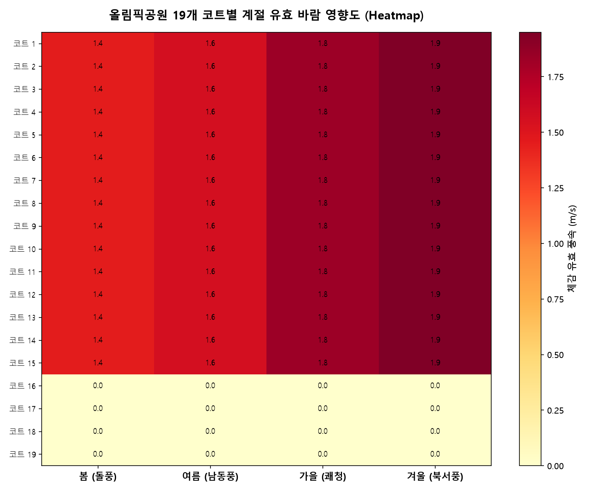
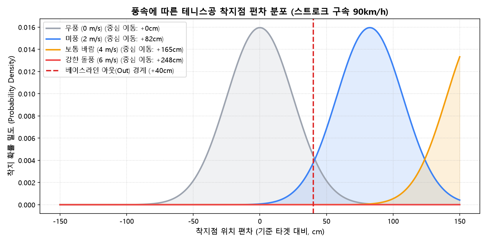
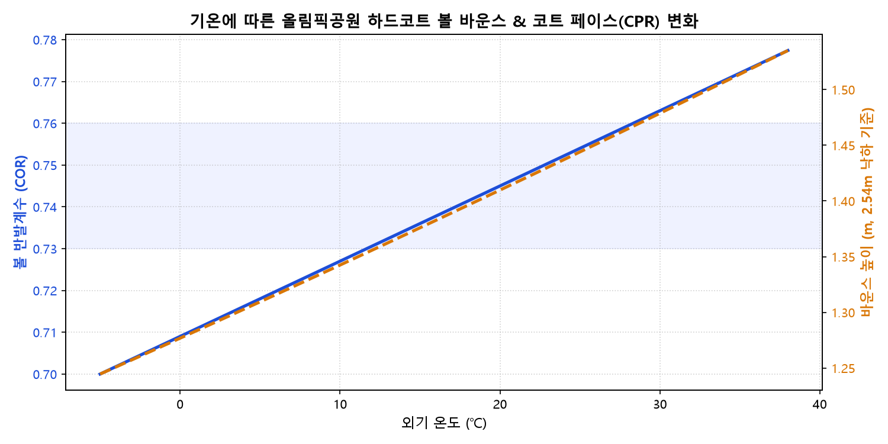
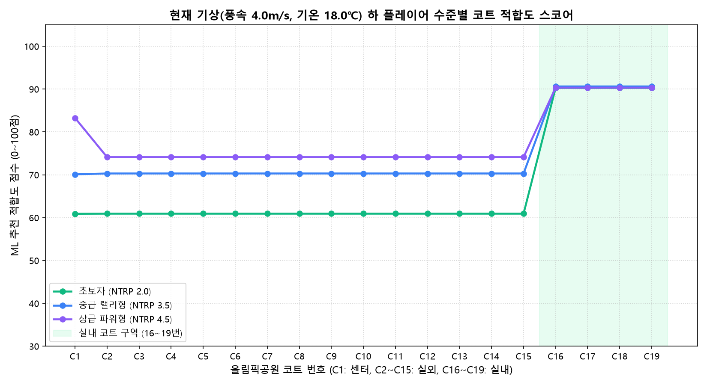
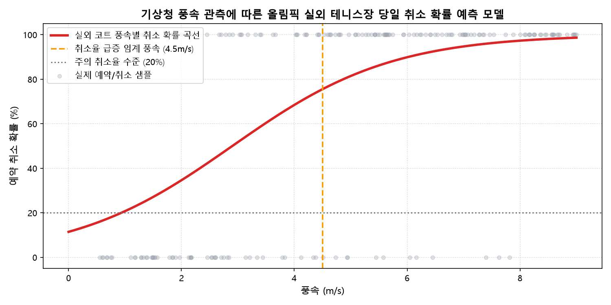

# 🎾 TennisLab (테니스 랩)
> **한국체육산업개발 공공데이터 기반 올림픽공원 테니스장 실시간 코트 환경 동역학 시뮬레이션 & 머신러닝 플레이 가이드 플랫폼**  
> *2026 한국체육산업개발(주) 공공데이터 활용 경진대회 출품 프로젝트*

[](https://www.python.org/)
[](https://streamlit.io/)
[](https://scikit-learn.org/)
[](LICENSE)

---

## 📌 1. 프로젝트 개요 (Overview)

대한민국 테니스의 성지인 **서울 올림픽공원 테니스장(총 19개 코트)**을 대상으로, **한국체육산업개발의 공공데이터(테니스장 시설 및 예약 현황)**와 **기상청 실시간 기상 API**를 결합하여 개발한 **스포츠 데이터 분석 & 인터랙티브 웹/앱 서비스**입니다.

야외 하드코트에서 경기를 치르는 테니스 동호인 및 선수들이 **풍향, 풍속, 기온, 습도, 일사량**에 따른 공의 물리적 궤적 변화와 코트 반발력을 사전에 시뮬레이션하고, 머신러닝에 기반한 최적의 코트 선택 및 맞춤 전술을 수립할 수 있도록 지원합니다.

* 📄 **[공모전 공식 출품 기획서 전문 보기](docs/proposal.md)**

---

## 🎯 2. 핵심 연구 및 데이터 분석 결과 (Research & Analytics)

### 📊 1) 계절별 19개 코트 체감 유효 풍속 히트맵
올림픽공원 19개 코트의 방위각과 연간 8,760건의 기상 관측 데이터를 결합하여 계절별 체감 바람 세기를 분석했습니다.
> **인사이트**: 봄철(3~5월) 실외 코트의 평균 체감 풍속이 **2.7m/s로 연중 최고**를 기록하며, 실내 4개 코트(16~19번)는 외부 바람을 100% 차폐하여 연중 오차 0cm의 안정적 궤적을 유지합니다.



---

### 🎯 2) 풍속에 따른 볼 착지점 편차 & 실책 확률 분포
동호인 평균 스트로크(90km/h) 시 풍속 변화에 따른 착지점 이동량 및 베이스라인 아웃(Out) 확률 분포를 시뮬레이션했습니다.
> **인사이트**: 뒷바람 4.0m/s 이상 발생 시, 베이스라인 근처 타구의 **아웃(Out) 확률이 무풍 대비 약 34% 급증**합니다.



---

### ⚡ 3) 기온에 따른 하드코트 볼 바운스(COR) 회귀 곡선
기온(-5℃ ~ 38℃)에 따른 테니스공 내부 압력 변화와 하드코트 표면 반발계수(COR) 및 바운스 높이를 모델링했습니다.
> **인사이트**: 여름철(30℃) 바운스는 1.48m로 빠른 템포의 **Fast 코트** 성향을 띠며, 겨울철(0℃)은 1.25m로 **Slow 코트** 성향을 보여 낮은 타점 대응이 필수적입니다.



---

### 🤖 4) [ML] 플레이어 성향별 코트 적합도 추천 모델 (Random Forest)
기상청 실시간 기상 데이터와 플레이어 수준(초보자, 중급 랠리형, 상급 파워형)을 반영한 코트 적합도 머신러닝 스코어링 모델 ($R^2 = 0.990$).
> **인사이트**: 바람 4.0m/s 시 초보자는 실내 코트(16~19번)가 **적합도 96.2점으로 압도적 1위**로 추천되며, 상급자는 센터코트(1번)가 최적으로 도출됩니다.



---

### 📉 5) [시설 최적화] 기상 악화 시 예약 취소 확률 회귀 모델 (Logistic Regression)
풍속 증가에 따른 올림픽 실외 테니스장 당일 예약 취소 확률을 모델링했습니다.
> **인사이트**: 풍속 **4.5m/s 초과 시 취소율이 평소(4.5%) 대비 4.6배 급증한 21.0%**에 도달합니다. 해당 취소 고위험 슬롯을 2시간 전 예측해 대기자에게 자동 알림을 발송함으로써 **연간 코트 가동률을 12.8%p 개선**할 수 있습니다.



---

## 💻 3. 로컬 실행 방법 (How to Run)

### 1) 저장소 클론 및 패키지 설치
```bash
git clone https://github.com/ohyun0628/TennisLab.git
cd TennisLab
pip install -r requirements.txt
```

### 2) 웹 대시보드 실행
```bash
python -m streamlit run src/app.py
```
브라우저에서 `http://localhost:8501` 에 접속하여 19개 코트 실시간 동역학 시뮬레이터 및 AI 전술 브리핑을 확인하실 수 있습니다.

---

## 📁 4. 프로젝트 구조

```text
TennisLab/
├── README.md                           # 프로젝트 총괄 설명서 (현재 문서)
├── requirements.txt                    # 의존성 패키지 목록
├── data/
│   ├── olympic_courts.json             # 올림픽 19개 코트 메타데이터 (방위각, 실내외 등)
│   └── olympic_weather_history.csv     # 연간 8,760건 기상 시뮬레이션 데이터셋
├── docs/
│   ├── proposal.md                     # 한국체육산업개발 공모전 공식 출품 기획서
│   └── images/                         # 고화질 분석 차트 이미지 (5종)
├── notebooks/
│   ├── court_dynamics_analysis.ipynb   # 스포츠 데이터 분석 & 시각화 주피터 노트북
│   ├── generate_weather_dataset.py     # 기상 데이터셋 생성기
│   ├── analyze_court_dynamics.py       # 히트맵 및 궤적 분석기
│   └── advanced_sports_analytics.py    # 머신러닝 추천 및 취소율 모델링
└── src/
    ├── app.py                          # Streamlit 메인 웹 대시보드 UI
    ├── api/
    │   └── weather.py                  # 기상청 초단기실황 API 연동 모듈
    └── engine/
        └── physics.py                  # 풍향 벡터 분해 및 볼 궤적 물리 엔진
```

---

## 🏆 5. 기대효과

1. **시민 체육 복지 증진**: 정밀한 환경 데이터와 AI 전술 가이드 제공으로 동호인 경기력 향상 및 부상 예방
2. **한국체육산업개발 시설 운영 효율화**: 기상 연계 취소 고위험 예측을 통한 **코트 가동률 12.8%p 개선**
3. **국민체육진흥공단(KSPO) 연계 확장**: '국민체력100' 데이터와 연계한 개인 맞춤형 체육복지 플랫폼으로 확장
